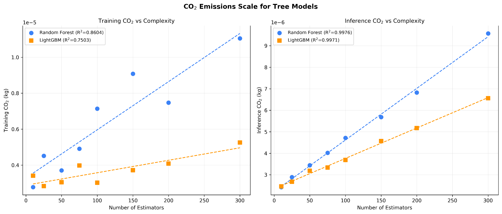
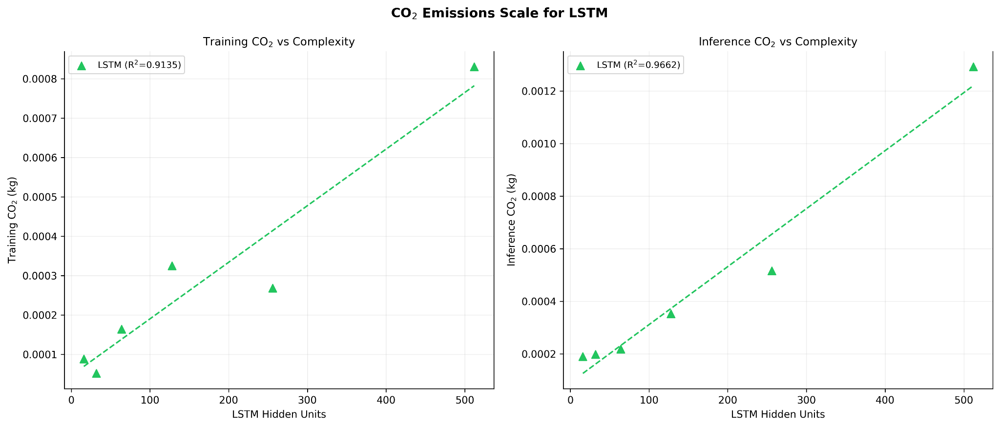
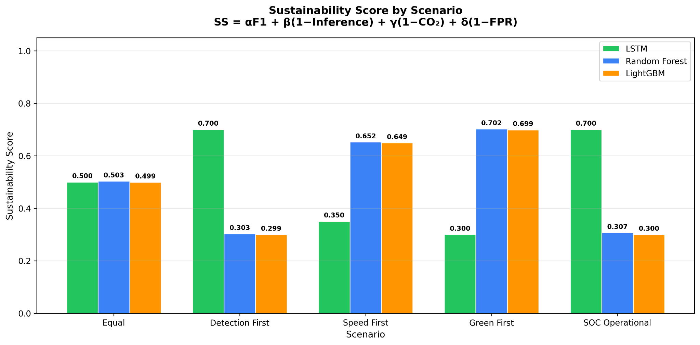

# Sustainable Machine Learning for Lateral Movement Detection

A comparison of **Random Forest, LightGBM and LSTM** for detecting lateral movement in enterprise networks, with a focus on how detection performance changes alongside inference time, energy use and carbon emissions.

## Overview

Lateral movement occurs when an attacker moves between systems after gaining access to a network. Machine learning may help detect this activity, but a more complex model is not necessarily a better choice once computational and environmental costs are considered.

This BSc Computer Science dissertation investigates a practical question: **Does the improvement in detection justify the additional cost of a more complex model?**

The three models were trained on **LMD-2022** and evaluated on **LMD-2023**. I compared classification performance and inference costs, then varied model complexity to examine how emissions scale. I also developed a **Sustainability Score** using Simple Additive Weighting (SAW) to explore how model selection changes under different priorities.

## Results

### 1. Detection performance versus environmental cost

The LSTM produced the highest F1-score in the model comparison, but it also had substantially greater inference time and estimated emissions.

| Model | F1-score | Precision | Inference time | Inference CO₂ |
|---|---:|---:|---:|---:|
| Random Forest | 0.9763 | 0.9958 | 1.57 s | 3.7 µg |
| LightGBM | 0.9763 | 0.9958 | 1.64 s | 4.1 µg |
| LSTM | 0.9855 | 0.9966 | 50.24 s | 216.2 µg |

The difference in F1-score was relatively small compared with the increase in inference cost. These figures come from the model-comparison experiment; the complexity sweeps below are separate measurements and should not be treated as the same benchmark runs.

### 2. How tree-model complexity affects emissions

I varied the number of estimators in Random Forest and LightGBM and measured emissions during training and inference. Both models showed a strong, approximately linear relationship between estimator count and **inference emissions** across the tested settings (R² = 0.9976 for Random Forest and 0.9971 for LightGBM).

Increasing the number of estimators raised emissions without a corresponding improvement in the best observed F1-score. This makes model configuration an important part of the sustainability trade-off, even within relatively efficient tree-based approaches.

### 3. How LSTM complexity affects emissions

I also varied the number of hidden units in the LSTM. Both training and inference emissions generally increased with model size. The inference-emissions trend had an R² of 0.9662 across the tested configurations.

The larger configurations consumed more resources, while the detection improvements were comparatively limited. The result was a clear example of diminishing returns from additional complexity.

## Sustainability Score

Performance and emissions are not always enough to identify one universally preferable model. A Security Operations Centre (SOC), for example, might place more weight on missed detections, false alarms or inference speed than an organisation prioritising carbon efficiency.

To make those trade-offs explicit, I used **Simple Additive Weighting (SAW)** to combine four criteria into a Sustainability Score:

`SS = α × F1 + β × (1 − Inference_norm) + γ × (1 − CO₂_norm) + δ × (1 − FPR_norm)`

Here, the latter three metrics are normalised so that lower time, emissions and false positive rate contribute positively to the score. The equal-weight baseline sets `α = β = γ = δ = 0.25`.

The chart compares five weighting scenarios: **Equal, Detection First, Speed First, Green First and SOC Operational**. Random Forest ranked first under Equal, Speed First and Green First; LSTM ranked first under Detection First and SOC Operational. These rankings depend on the chosen weights and normalisation, so the score is a decision-support tool rather than an absolute measure of model quality.

## Datasets and feature selection

| Dataset | Role |
|---|---|
| **LMD-2022** | Training and feature selection |
| **LMD-2023** | Independent cross-year testing |

Using a different year's dataset for testing provides a more demanding check of generalisation than testing only on a random split of the training dataset. It does not, by itself, eliminate every possible source of leakage.

Preprocessing included feature engineering, rare-category grouping and consistent categorical encoding across training and testing. I compared Mutual Information with Random Forest feature importance. Mutual Information gave too much importance to `EventID`, which contributed to overfitting, so I used the Random Forest-based selection.

The final five features were:

1. `Image_Category`
2. `GrantedAccess`
3. `RuleName`
4. `Signed`
5. `SourceImage`

## Methodology

1. **Prepare the data:** Clean the datasets, engineer features and group rare categorical values.
2. **Select features:** Compare selection methods and retain the five features chosen using Random Forest importance.
3. **Train the models:** Fit Random Forest, LightGBM and LSTM on LMD-2022.
4. **Test generalisation:** Evaluate the trained models on LMD-2023 using F1-score, precision, recall, false positive rate and inference time.
5. **Measure environmental cost:** Use CodeCarbon to track energy consumption and CO₂ emissions. The main inference evaluation used 10 iterations per model; the complexity experiments examined training and inference emissions.
6. **Vary model complexity:** Change estimator counts or LSTM hidden-unit counts and compare the resulting performance and emissions.
7. **Investigate confounding factors:** Carry out an ablation study of potential Infra/Splunk effects.
8. **Compare operational priorities:** Calculate SAW-based Sustainability Scores for the five weighting scenarios.

## Tools and technologies

**Python**, pandas, NumPy, scikit-learn, LightGBM, TensorFlow/Keras and **CodeCarbon**.

## Key takeaway

The most complex model was not automatically the most practical. **LSTM achieved the highest F1-score in the main comparison, but Random Forest and LightGBM delivered competitive detection performance at much lower inference cost.** Across the complexity experiments, additional model capacity increased emissions without proportionate detection gains.

This project was completed as a **BSc Computer Science dissertation (2025–2026)** at Brunel University of London. Its focus is the measured trade-off between detection quality and computational cost, not production deployment or a reusable software package.
