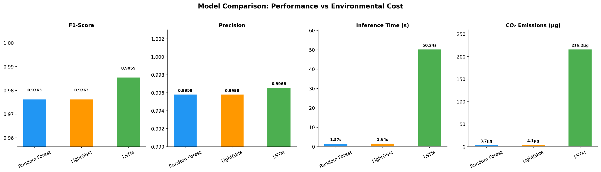

# Sustainable Machine Learning for Lateral Movement Detection

A comparison of **Random Forest, LightGBM and LSTM** for detecting lateral movement in enterprise networks, examining detection performance, inference time, energy consumption and carbon emissions.

## Overview

Lateral movement occurs when an attacker moves between systems after gaining access to a network. Machine learning can help detect this activity, but more complex models also require more computational resources.

This BSc Computer Science dissertation investigates a practical question: **Does improving detection performance justify the additional computational and environmental cost of more complex models?**

Three models were trained on **LMD-2022** and evaluated on **LMD-2023** to assess cross-year generalisation. I compared classification performance, inference time and carbon emissions, then varied model complexity to examine how resource consumption changes.

I also developed a **Sustainability Score** using Simple Additive Weighting (SAW) to explore how model selection changes depending on operational priorities.

## Results

### Detection Performance vs Environmental Cost

The LSTM achieved the highest F1-score in the main comparison, but required substantially more inference time and produced higher estimated carbon emissions.

| Model | F1-score | Precision | Inference Time | CO₂ Emissions |
|---|---:|---:|---:|---:|
| Random Forest | 0.9763 | 0.9958 | 1.57 s | 3.7 µg |
| LightGBM | 0.9763 | 0.9958 | 1.64 s | 4.1 µg |
| LSTM | 0.9855 | 0.9966 | 50.24 s | 216.2 µg |

Although LSTM improved the F1-score, the increase was relatively small compared with its additional inference cost.

Random Forest and LightGBM achieved competitive detection performance with considerably lower inference time and emissions.

These results illustrate why detection performance alone may not be sufficient when selecting models for operational cybersecurity systems.

### Model Complexity and Carbon Emissions

I also investigated how changing model complexity affected energy consumption, emissions and detection performance.

For **Random Forest and LightGBM**, I varied the number of estimators and measured emissions during training and inference. Increasing the estimator count generally increased emissions without improving the best observed F1-score.

For **LSTM**, I varied the number of hidden units. Larger configurations required more computational resources, while improvements in detection performance were comparatively limited.

These experiments showed that increasing model complexity does not necessarily provide a proportional improvement in detection performance.

The complexity experiments were conducted separately from the main model comparison.

## Sustainability Score

The model with the highest detection performance is not necessarily the best choice for every organisation.

For example, a Security Operations Centre (SOC) might prioritise reducing false positives and inference time, while another organisation might place greater importance on carbon emissions.

To explore these trade-offs, I developed a **Sustainability Score (SS)** using Simple Additive Weighting (SAW).

The score combines four criteria:

- F1-score
- False Positive Rate (FPR)
- Inference Time
- CO₂ Emissions

The formula is:

$$
SS = \alpha F1 + \beta(1 - Inference_{norm}) + \gamma(1 - CO_{2,norm}) + \delta(1 - FPR_{norm})
$$

The cost metrics are normalised so that lower inference time, emissions and false positive rates contribute positively to the score.

The baseline uses equal weights:

$$
\alpha = \beta = \gamma = \delta = 0.25
$$

I evaluated five weighting scenarios:

1. **Equal:** All four criteria receive equal weight.
2. **Detection First:** Prioritises detection performance.
3. **Speed First:** Prioritises inference time.
4. **Green First:** Prioritises lower carbon emissions.
5. **SOC Operational:** Reflects operational security priorities.

The Sustainability Score is intended as a decision-support tool rather than an absolute measure of model quality. Model rankings depend on the criteria, normalisation and weights selected.

## Datasets and Feature Selection

Two lateral movement detection datasets were used:

- **LMD-2022:** Used for model training and feature selection.
- **LMD-2023:** Used for independent cross-year testing.

Training and testing on different years provides a more demanding assessment of generalisation than relying entirely on a random split of one dataset. However, this approach does not eliminate every potential source of data leakage.

### Feature Engineering

Preprocessing included:

- Data cleaning and feature engineering
- Grouping rare categorical values
- Encoding categorical features
- Maintaining consistent feature representations across training and testing

I compared Mutual Information with Random Forest feature importance for feature selection.

Mutual Information gave excessive importance to `EventID`, which contributed to overfitting. Random Forest importance was therefore used to select the final features.

The five selected features were:

1. `Image_Category`
2. `GrantedAccess`
3. `RuleName`
4. `Signed`
5. `SourceImage`

## Methodology

The research followed eight stages.

1. **Data Preprocessing:** Cleaned the datasets, engineered features, grouped rare categories and encoded categorical variables.

2. **Feature Selection:** Compared feature selection methods and retained five features using Random Forest importance.

3. **Model Training:** Trained Random Forest, LightGBM and LSTM on LMD-2022 using consistent preprocessing.

4. **Cross-Year Evaluation:** Tested the trained models on LMD-2023 using F1-score, precision, recall, false positive rate and inference time.

5. **Carbon Measurement:** Used CodeCarbon to measure energy consumption and CO₂ emissions. The main inference evaluation used 10 iterations per model.

6. **Complexity–Emissions Analysis:** Varied estimator counts for Random Forest and LightGBM and hidden-unit counts for LSTM to examine the relationship between complexity, detection performance and emissions.

7. **Ablation Study:** Investigated potential Infra/Splunk confounding effects on model evaluation.

8. **Sustainability Scoring:** Applied Simple Additive Weighting across five operational scenarios to compare model suitability under different priorities.

## Tools and Technologies

- **Python** - Data preprocessing, feature engineering and experimentation
- **pandas and NumPy** - Data manipulation and numerical processing
- **scikit-learn** - Random Forest, feature selection and evaluation metrics
- **LightGBM** - Gradient-boosted decision trees
- **TensorFlow/Keras** - LSTM implementation
- **CodeCarbon** - Energy consumption and carbon-emissions measurement

## Key Takeaway

**The most complex model was not necessarily the most practical, but the most efficient model was not always the best choice either.**

Random Forest and LightGBM achieved detection performance close to LSTM while requiring considerably less inference time and producing lower emissions. This makes tree-based models better suited to the first stage of detection, where large volumes of network activity need to be processed.

LSTM could be more useful as a second-stage model, analysing suspicious activity flagged by the tree-based models. Its ability to capture temporal dependencies may help identify more complex attacks that simpler models miss, without applying its higher computational cost to every event.

This also raises an important consideration around Red AI: greater computational cost may be justified when the additional detection capability provides sufficient operational benefit. In cybersecurity, preventing a serious breach could potentially avoid resource-intensive recovery operations and their associated emissions.

While this two-stage approach was not experimentally evaluated, it offers a direction for future research into balancing detection effectiveness, operational efficiency and environmental sustainability.

---

**Research Context:** This project was completed as a BSc Computer Science dissertation (2025–2026) at Brunel University of London. It focuses on evaluating the performance and environmental cost of machine learning for lateral movement detection rather than production deployment.
